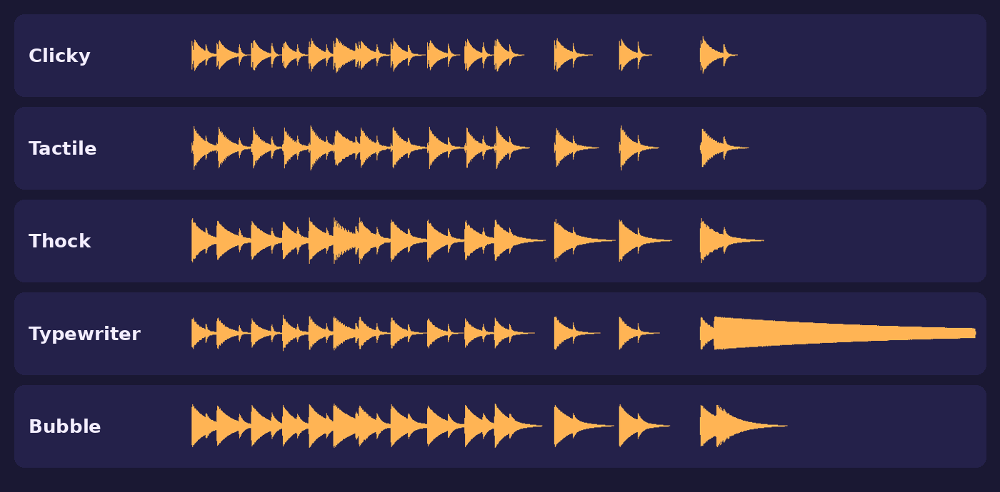
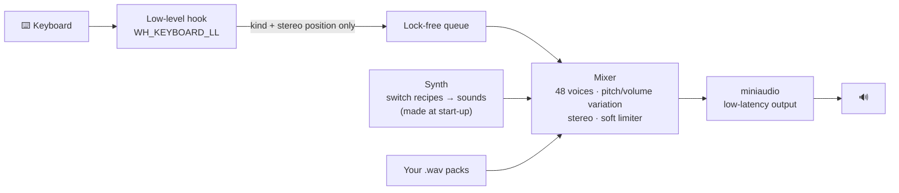

<div align="center">

# 🌊⌨️ TypeWave

**Make any keyboard sound like a mechanical one.**
Realistic switch sounds for every key, made live in code: no sound files, no lag, no cut-off clicks. And it never records what you type.


<p>
  
  
  
  
  
</p>



<sub>The five built-in packs typing <code>HELLO WORLD</code>, Backspace, <code>D</code>, Enter. 🎧 Listen: <a href="assets/previews/clicky.wav">Clicky</a> · <a href="assets/previews/tactile.wav">Tactile</a> · <a href="assets/previews/thock.wav">Thock</a> · <a href="assets/previews/typewriter.wav">Typewriter</a> · <a href="assets/previews/bubble.wav">Bubble</a></sub>

</div>

---

## ✨ What it does

| | |
| --- | --- |
| 🎛️ **5 switch styles** | **Clicky** (sharp click and bottom-out), **Tactile** (soft bump), **Thock** (deep and smooth), **Typewriter** (with a bell on Enter), **Bubble** (playful pops) |
| 🔑 **Every key sounds right** | Space, Enter, Backspace and modifier keys are bigger keys, so they sound lower and longer. The space bar even rattles a little, like real stabilisers |
| ⬇️⬆️ **Press and release** | A "clack" going down and a lighter "tick" coming up, like a real switch |
| 🎲 **Never robotic** | Every press picks one of several variations, with a tiny random change in pitch and volume |
| 🎧 **Stereo** | Keys on the left of the keyboard sound on the left, keys on the right on the right |
| ⚡ **No lag, no cut-offs** | A real audio mixer (up to 48 sounds at once, about 10–20 ms delay). Fast typing never cuts sounds off, unlike `PlaySound()` |
| 🧩 **Your own sounds** | Drop `.wav` files in a folder to make your own pack, with variations and release sounds |
| 🖱️ **Tray app** | Pick the pack and volume, turn release sounds or stereo on and off, and start with Windows. **Ctrl + Alt + K** mutes from anywhere |
| 🪶 **Tiny** | One 1.6 MB `.exe` with no installer and no runtime to install. Sounds are made in code when it starts |

## 🔒 Privacy

TypeWave has to listen to the keyboard to play sounds, so here is exactly what it does with that:

- It only looks at **what kind of key** was pressed (letter, space, Enter, Backspace or modifier) and roughly **where it sits on the keyboard** (for stereo).
- It **never stores, logs or sends** which keys you press. There's no typing history, no file of keys and no network code.
- The settings file holds only your preferences (pack, volume, switches on or off).
- Keys sent by other programs (macros, remote-desktop tools) are ignored.

The keyboard code is about 20 lines: [`keyboardHook` in `src/main_win.cpp`](src/main_win.cpp). Check it yourself.

## 🚀 Get it

**Easiest:** download `typewave.exe` from the [latest release](../../releases), or from the newest [**Build** workflow run](../../actions/workflows/build.yml) under *Artifacts*. Double-click it, start typing, and look for the keycap icon in the system tray (bottom right, near the clock).

> Windows may show "Windows protected your PC" for new unsigned apps. Click **More info → Run anyway**, or build it yourself (below).

### Build it yourself

**Option A: Visual Studio or CMake**
```bash
cmake -S . -B build
cmake --build build --config Release
```
The app is at `build/Release/typewave.exe`.

**Option B: MinGW g++ (no CMake)**
Install [MSYS2](https://www.msys2.org), run `pacman -S mingw-w64-ucrt-x86_64-gcc`, then double-click **`build.bat`**. Under the hood it runs:
```bash
g++ -std=c++17 -O2 -municode -mwindows -static src/*.cpp res.o -o typewave.exe -luser32 -lshell32 -lole32 -ladvapi32 -luuid
```

**Cross-compile from Linux:** `cmake -S . -B build-win -DCMAKE_TOOLCHAIN_FILE=cmake/mingw-w64.cmake`

## 🖱️ Using it

Click or right-click the tray icon:

- **Sounds on** (also **Ctrl + Alt + K** anywhere)
- **Sound pack** → Clicky, Tactile, Thock, Typewriter, Bubble, plus your own packs
- **Volume** → 10 % to 100 %
- **Key release sounds** and **Stereo** on or off
- **Open sound packs folder** and **Reload sound packs**
- **Start with Windows**
- **About and privacy**, **Quit**

Settings are saved in `%APPDATA%\TypeWave\settings.ini`.

## 🧩 Make your own sound pack

1. Tray menu → **Open sound packs folder** (`%APPDATA%\TypeWave\packs`).
2. Make a folder with your pack's name, for example `My Keyboard`.
3. Put `.wav` files in it:

| File | Plays for |
| --- | --- |
| `key.wav` **(required)** | any normal key |
| `space.wav` | space bar |
| `enter.wav` | Enter |
| `backspace.wav` | Backspace and Delete |
| `modifier.wav` | Shift, Ctrl, Alt, Tab, Caps Lock, Esc, Windows key |

- Add **`_up`** for the release sound: `key_up.wav`, `space_up.wav`, …
- Add **numbers** for variations to pick between at random: `key1.wav`, `key2.wav`, `key3.wav`, …
- Missing sounds fall back to `key.wav`.

4. Tray menu → **Reload sound packs**, then pick your pack.

Tip: record your own keyboard with your phone, or use sounds you have the rights to (for example CC0).

## 🛠️ How it works



- **`src/synth.cpp`:** each switch style is a short recipe of damped resonances and filtered noise bursts (for example, Clicky = click-jacket snap + bottom-out 9 ms later). It renders 6 variations per key type, for press and release.
- **`src/engine.cpp`:** a single-producer/single-consumer lock-free queue from the keyboard hook to the audio thread, and a 48-voice mixer with equal-power stereo panning and a soft limiter. The hook never waits on audio.
- **`src/audio.cpp`:** [miniaudio](https://miniaud.io) for low-latency output (WASAPI) and for decoding `.wav` packs.
- **`src/main_win.cpp`:** the tray icon, menu, hotkey, start-with-Windows option, and the keyboard hook.
- **`tests/test_core.cpp`:** 665 checks on the sound engine (no clipping, sounds start fast and end cleanly, voices overlap and get reused, mute and release options, stereo, settings). Run them with `ctest --test-dir build -C Release`.
- **`tools/preview.cpp`:** renders the demo `.wav` files in `assets/previews/`.

## 🗺️ Roadmap

- [x] v1: 5 synthesised switch styles, press and release sounds, variations, stereo, tray menu, mute hotkey, custom packs, start with Windows
- [ ] Auto-mute in calls (Zoom, Teams, Meet) and in chosen apps
- [ ] Quiet hours, and volume that follows how fast you type
- [ ] Different packs for different apps (typewriter in Word, thock in VS Code)
- [ ] Typing stats (counts only, never which keys) and a key-usage heatmap
- [ ] Optional on-screen ripple effects

## 🙏 Credits

- Audio output and decoding: [miniaudio](https://github.com/mackron/miniaudio) by David Reid (public domain / MIT-0), in `third_party/miniaudio/`.
- All built-in sounds are synthesised by TypeWave itself.

## 📄 License

MIT © Hemashree V I
